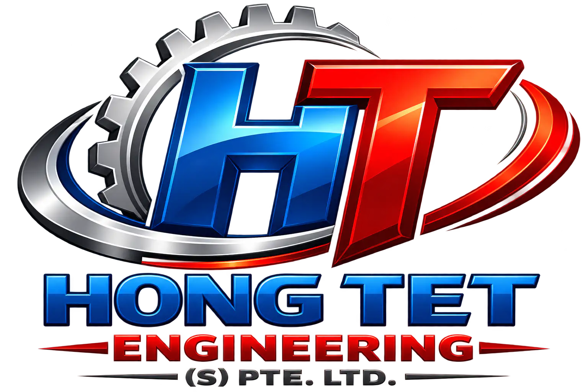

# HONG TET ENGINEERING (S) PTE. LTD.

<div align="center">



<p align="center">
  <strong>Premier Engineering, Structural Steel Fabrication, Roofing Solutions & Skilled Manpower in Singapore</strong>
</p>

[](https://nextjs.org/)
[](https://react.dev/)
[](https://www.typescriptlang.org/)
[](https://tailwindcss.com/)
[](https://lenis.darkroom.engineering/)
[](https://www.bca.gov.sg/)
[](https://pnpm.io/)

[Overview](#-overview) •
[Core Services](#-core-services--solutions) •
[Tech Stack](#-tech-stack--architecture) •
[Project Structure](#-project-structure) •
[Pages & Routes](#-pages--routes) •
[MDX Blog Engine](#-mdx-blog-engine) •
[Getting Started](#-getting-started) •
[Contact & Inquiries](#-official-contact--inquiries)

---

</div>

## 🌟 Overview

**HONG TET ENGINEERING (S) PTE. LTD.** is an engineering and construction contractor in Singapore. The web platform delivers a performance-oriented, responsive, and modern digital experience showcasing structural steel fabrication, industrial roofing, architectural metalwork, and certified engineering manpower services.

Built with **Next.js 16 (App Router)** and **React 19**, the application combines an industrial aesthetic (safety orange, industrial dark tones, textured off-whites) with physics-based smooth scrolling, fluid animations, and a file-based MDX publishing system.

---

## 🏗️ Core Services & Solutions

| # | Service Category | Description & Capabilities |
|---|---|---|
| **01** | **Metal Structure Fabrication & I-Beams** | Complete fabrication and erection of structural steel frameworks, industrial I-beam framing, warehouse mezzanine platforms, and custom heavy-load components built to Singapore standards. |
| **02** | **Roofing & Shelter Solutions** | Weatherproof industrial roofing and canopy installations built for tropical durability using zinc sheets, clay roof tiles, polycarbonate skylights, and composite insulated panels. |
| **03** | **Metal & Stainless-Steel Works** | Precision fabrication of architectural metal fittings: 304/316 grade stainless-steel railings, ADA-compliant handrails, heavy-duty driveway main gates, and spiral/industrial staircases. |
| **04** | **Architectural Glass Installation** | Spatial elegance combined with BCA structural safety: frameless tempered glass doors, storefronts, structural acoustic windows, and laminated glass balustrades. |
| **05** | **Renovation & Protective Painting** | End-to-end spatial alterations, interior and exterior building additions & alterations (A&A), anti-corrosion protective coatings, and commercial office fit-outs. |
| **06** | **Skilled Manpower Supply** | Certified, BCA-compliant engineering workforce including structural welders (3G/4G/6G), metal fitters, riggers, and site supervisors deployed for Singapore projects. |

---

## ⚡ Tech Stack & Architecture

### Frontend Core
- **Framework:** [Next.js 16.4.3](https://nextjs.org/) (App Router, Server & Client Components)
- **Library:** [React 19.3.0](https://react.dev/) with [React Compiler](https://react.dev/learn/react-compiler) (`babel-plugin-react-compiler`)
- **Language:** [TypeScript 5](https://www.typescriptlang.org/) for strict type safety
- **Styling:** [Tailwind CSS v4](https://tailwindcss.com/) with `@tailwindcss/turbopack`
- **Component Primitives:** `@base-ui/react`, `shadcn/ui`, `class-variance-authority` (cva), `clsx`, `tailwind-merge`

### Animations & UX
- **Smooth Scrolling:** [Lenis](https://lenis.darkroom.engineering/) (`lenis@1.3.27`) with momentum-based scroll smoothing
- **Motion & Interactions:** [Framer Motion](https://www.framer.com/motion/) (`v14.6.0`) & [GSAP](https://greensock.com/gsap/) (`v3.15.0`)
- **Icons:** [Lucide React](https://lucide.dev/) (`lucide-react@1.61.0`)

### Content & CMS
- **Engine:** [next-mdx-remote](https://github.com/hashicorp/next-mdx-remote) (`v6.0.0`) & [gray-matter](https://github.com/jonschlinkert/gray-matter) (`v4.0.3`)
- **Typography:** Google Fonts (`Roboto` via `next/font/google`)

---

## 📁 Project Structure

```bash
hong_tet_engineering/
├── content/                     # MDX Engineering Guides & Technical Articles
│   ├── bca-safety-standards-architectural-glass-and-railings.mdx
│   ├── industrial-zinc-roofing-and-polycarbonate-skylights.mdx
│   └── structural-steel-i-beam-installation-singapore.mdx
├── public/                      # Static Assets (Images, Icons, Logos, Manifest)
│   ├── Projects/                # Portfolio & Case Study Imagery
│   ├── logo/                    # High-res vector & webp brand logos
│   ├── services/                # Specialized service gallery assets
│   ├── favicon.ico              # Multi-resolution favicons & web manifest
│   └── site.webmanifest         # PWA Manifest configuration
├── src/
│   ├── app/                     # Next.js App Router (Pages, Layouts, Metadata)
│   │   ├── layout.tsx           # Global Root Layout with Lenis & SEO Metadata
│   │   ├── globals.css          # Tailwind CSS v4 setup & theme variables
│   │   ├── page.tsx             # Home Landing Page
│   │   ├── about/               # About Us & Company Profile
│   │   ├── services/            # Full Services Breakdown & Engineering Capabilities
│   │   ├── projects/            # Completed Projects, Case Studies & Gallery
│   │   ├── blog/                # MDX Blog Listing Page with category filtering
│   │   │   └── [slug]/          # Dynamic MDX Blog Post Reader Page
│   │   └── contact/             # Contact Us, Inquiry Form & Interactive Details
│   ├── components/              # Modular UI Components
│   │   ├── ui/                  # Reusable atom-level primitives (Buttons, etc.)
│   │   ├── Navbar.tsx           # Sticky Header with responsive navigation
│   │   ├── HeroSection.tsx      # Main Hero Banner with interactive CTAs
│   │   ├── ServicesSection.tsx  # Interactive Services grid with detail modals
│   │   ├── ProcessSection.tsx   # 4-step engineering workflow & methodology
│   │   ├── ProjectsSection.tsx  # Framer-Motion animated project showcase
│   │   ├── TestimonialsSection.tsx # Client reviews & industry certifications
│   │   ├── ServiceAreaSection.tsx  # Singapore islandwide service coverage map
│   │   ├── FaqSection.tsx       # Expandable engineering & BCA compliance FAQ
│   │   ├── ContactSection.tsx   # High-converting lead generation form
│   │   ├── MarqueeStrip.tsx     # Infinite animated brand ticker
│   │   ├── Footer.tsx           # Company credentials, sitemap & contact links
│   │   └── SmoothScroll.tsx     # Lenis provider for smooth inertia scroll
│   └── lib/
│       ├── blog.ts              # File-system MDX parser & metadata extractor
│       └── utils.ts             # Tailwind classnames merger helper (cn)
├── AGENTS.md                    # Agent rules, contact constants & Next.js directives
├── components.json              # Shadcn component configuration
├── next.config.ts               # Next.js build & compiler options
├── package.json                 # Project dependencies and script runner
├── pnpm-lock.yaml               # Deterministic pnpm dependency graph
└── tsconfig.json                # TypeScript compiler configuration
```

---

## 🚀 Pages & Routes

| Route | Page | Purpose & Key Features |
|---|---|---|
| `/` | **Home** | Comprehensive brand presentation: Hero, Services, Process, Projects showcase, Reviews, Islandwide coverage, FAQ & Contact. |
| `/about` | **About Us** | Corporate background, safety compliance standards (BCA/WSH), values, milestone timeline, and core leadership. |
| `/services` | **Services** | Deep-dive into structural steel, roofing, architectural railings, glass installations, and manpower supply with technical specs. |
| `/projects` | **Projects** | Filterable portfolio of completed Singapore contracts with categories (Industrial, Commercial, Residential). |
| `/blog` | **Engineering Blog** | Searchable technical articles on BCA standards, welding methods, roofing care, and engineering insights. |
| `/blog/[slug]` | **Article Detail** | Full MDX rendered technical guides with reading time, author info, styled typography, and related callouts. |
| `/contact` | **Contact** | Direct telephone and email links, interactive inquiry form, office location, and instant WhatsApp chat. |

---

## 🎨 Design System & Visual Tokens

The website adheres to an industrial, precision-engineered design language:

| Design Token | Value / Preview | Usage |
|---|---|---|
| **Primary Accent** | `#FA551E` (Safety Orange) | Primary CTAs, active links, badges, hover accents |
| **Dark Base** | `#1A1A1A` / `#222222` (Industrial Charcoal) | Main headings, cards, dark section backgrounds |
| **Light Canvas** | `#FBF9F5` (Warm Cream White) | Page primary background, clean reading contrast |
| **Surface Cream** | `#F4F2EB` (Muted Sand) | Footer, secondary cards, border contrast |
| **Typography** | `Roboto` (100–900 variable weights) | Crisp, modern technical readability across all devices |
| **Borders & Rules** | `#E5E2D9` / `#E5E7EB` | Subtle structural division lines echoing blueprint grids |

---

## 📝 MDX Blog Engine

Articles are authored in standard Markdown/MDX inside `/content`:

```mdx
---
title: "BCA Safety Standards for Architectural Glass & Railings"
date: "2025-02-15"
category: "Architectural Metalwork"
excerpt: "A comprehensive guide to SS 332 and BCA structural codes for commercial balustrades in Singapore."
image: "/services/stock-image/carpenter-holds-drill-drills-window.jpg"
author: "Hong Tet Engineering Technical Team"
featured: true
---

## Technical Specifications
Every installation complies with Singapore Building and Construction Authority (BCA) specifications...
```

- **Reading Time:** Automatically computed at build/runtime (`lib/blog.ts`).
- **Dynamic Routing:** Powered by `getPostBySlug` and `getAllPosts`.
- **Formatting:** Syntax-highlighted headings, callout boxes, and technical tables.

---

## 🛠️ Getting Started

### Prerequisites

Ensure you have installed:
- [Node.js](https://nodejs.org/) `>= 20.0.0`
- [pnpm](https://pnpm.io/) `>= 10.0.0`

### 1. Clone the repository

```bash
git clone https://github.com/username/hong_tet_engineering.git
cd hong_tet_engineering
```

### 2. Install dependencies

```bash
pnpm install
```

### 3. Run the development server

```bash
pnpm dev
```

Open [http://localhost:3000](http://localhost:3000) in your browser.

### 4. Build for Production

```bash
# Type check and build optimized bundle
pnpm build

# Start production server locally
pnpm start
```

### 5. Lint & Code Quality

```bash
pnpm lint
```

---

## 📞 Official Contact & Inquiries

For structural steel fabrication, industrial roofing quotes, architectural metalwork, and certified manpower deployment in Singapore:

- **Company Name:** HONG TET ENGINEERING (S) PTE. LTD.
- **Phone Number:** `+65 9898 9760`
- **Call Link:** [tel:+6598989760](tel:+6598989760)
- **WhatsApp Direct:** [Chat on WhatsApp](https://wa.me/6598989760)
- **Email Address:** `renumohal1995@gmail.com`
- **Email Link:** [renumohal1995@gmail.com](mailto:renumohal1995@gmail.com)
- **Registered Address:** 217 Bukit Batok Street 21, #04-371, Singapore 650217

---

<div align="center">

© 2026 **HONG TET ENGINEERING (S) PTE. LTD.** All rights reserved.  
*Precision Engineering. Uncompromising Quality. Built to Last.*

</div>
